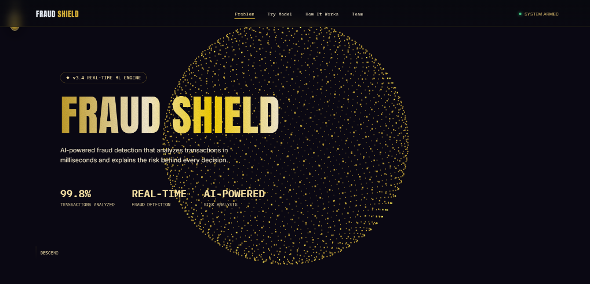
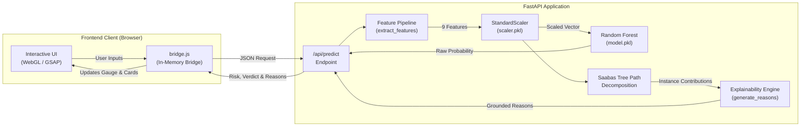
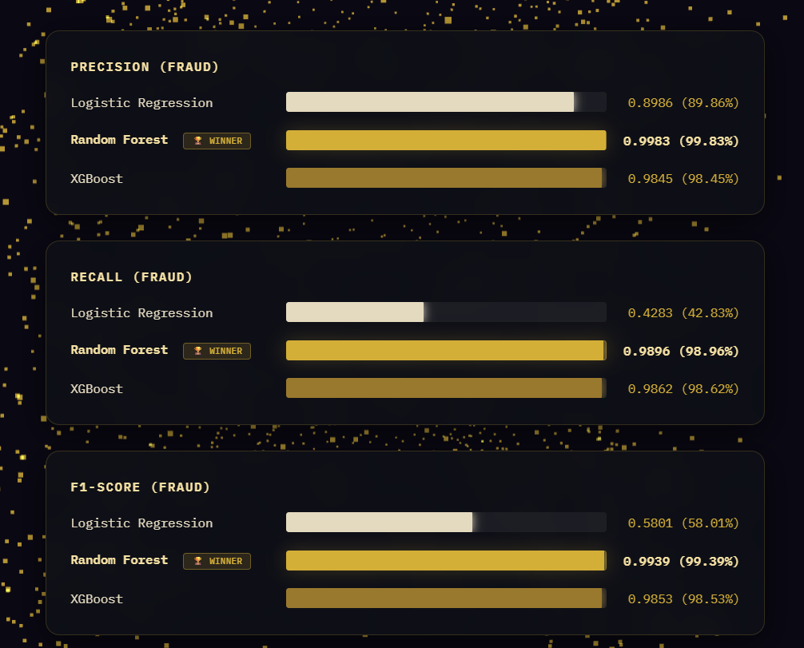
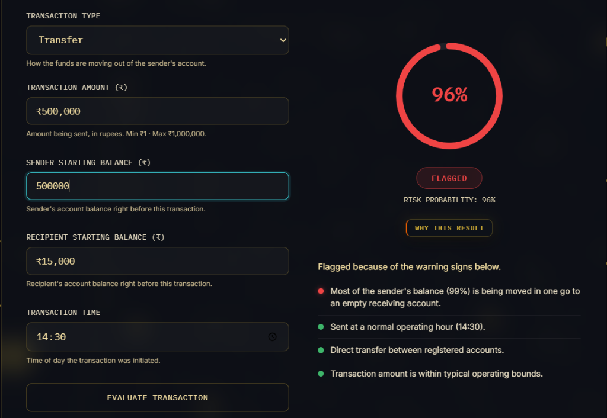

# FRAUD SHIELD

> **AI-powered fraud detection that analyzes transactions in milliseconds and explains the risk behind every decision.**

[](https://www.python.org/)
[](https://fastapi.tiangolo.com/)
[](https://scikit-learn.org/)
[](https://xgboost.readthedocs.io/)
[](docs/TESTING.md)
[](LICENSE)

---

## Overview



FRAUD SHIELD is an end-to-end machine learning system designed to protect digital payment ecosystems against fraudulent transfers and unauthorized cash-out attacks. By combining an optimized Random Forest classifier with tree-path contribution analysis (Saabas algorithm), it delivers **99.39% fraud F1-score**, sub-20ms inference latency, and human-readable explanations that demystify every flagged transaction.

**[Jump to Quick Start](#getting-started)** | **[Interactive UI](http://127.0.0.1:8000/)** | **[Architecture Docs](docs/ARCHITECTURE.md)** | **[API Docs](docs/API.md)**

---

## Table of Contents

- [The Problem](#the-problem)
- [Key Features](#key-features)
- [How It Works](#how-it-works)
- [Model Benchmark & Evaluation](#model-benchmark--evaluation)
- [Tech Stack](#tech-stack)
- [Project Layout](#project-layout)
- [Getting Started](#getting-started)
- [Using the System](#using-the-system)
- [API Reference](#api-reference)
- [Testing](#testing)
- [Limitations & Ethical Considerations](#limitations--ethical-considerations)
- [Future Improvements](#future-improvements)
- [Team & Acknowledgments](#team--acknowledgments)
- [License](#license)

---

## The Problem

Financial fraud is among the most challenging domains in applied machine learning:

1. **Extreme Class Imbalance:** Fraud represents less than **0.2%** of all transactions in real-world mobile payment streams.
2. **The Accuracy Paradox:** A naive model that classifies every transaction as legitimate achieves **99.8% raw accuracy** while detecting exactly **0% of actual fraud**.
3. **High Cost of Errors:**
   - **False Negatives (Missed Fraud):** Direct capital loss, regulatory penalties, and compromised user trust.
   - **False Positives (Blocked Customers):** Legitimate users rejected at checkout, operational strain on compliance analysts, and customer churn.

A production-viable system cannot rely on accuracy alone; it requires high precision, near-perfect recall, sub-second latency, and interpretable audit trails.

---

## Key Features

- ⚡ **Sub-20ms Real-Time Inference:** Instantaneous fraud scoring via an optimized 50-tree Random Forest ensemble.
- 🔍 **Model-Grounded Explainability:** Uses exact decision tree path decomposition (Saabas contribution method) to trace how each feature pushed risk up or down.
- 🛡️ **Four Telemetry Risk Signals:** Translates raw tree weights into plain language grouped by:
  - `balance_behavior`: Account depletion percentage and ledger consistency.
  - `time_pattern`: Off-peak night hours vs. standard operating windows.
  - `transaction_type`: High-velocity transfers vs. unmonitored cash-out sinks.
  - `amount_pattern`: Capital scale relative to operational thresholds.
- 🚫 **Deterministic Overdraft Safeguards:** Detects impossible transactions (`amount > sender_balance`) as accounting anomalies and flags them with a Level 2 warning rather than silently clearing them.
- 📊 **Multi-Model Benchmark Transparency:** Full side-by-side performance comparisons across Logistic Regression, Random Forest, and XGBoost.
- 🎨 **Non-Invasive UI Architecture:** The client interface on disk is strictly read-only; an in-memory runtime bridge connects the browser to the FastAPI backend dynamically.

---

## How It Works



### System Flow in 5 Steps:
1. **User Input:** The operator specifies 5 transaction attributes: transaction type, amount, sender starting balance, recipient starting balance, and time of day.
2. **Feature Engineering:** The backend derives 9 model features, parsing time into continuous fractional hours (`step`) and calculating ledger accounting deltas (`errorBalanceOrig`, `errorBalanceDest`).
3. **Single Scaler Transformation:** Features are normalized using the fitted `StandardScaler` from training.
4. **Ensemble Scoring & Tree Path Attribution:** The Random Forest computes the fraud probability across 50 decision trees, while node transitions decompose exact instance contributions ($\phi_{\text{time}}, \phi_{\text{amount}}, \phi_{\text{balance}}, \phi_{\text{type}}$).
5. **Grounded Explanations:** The system assigns calibrated warning levels (Level 0 Gray, Level 1 Amber, Level 2 Red), guaranteeing that cleared transactions never exhibit critical red warnings and impossible inputs are never cleared.

---

## Model Benchmark & Evaluation



Three candidate architectures were trained and benchmarked on an 80/20 stratified split of the PaySim financial dataset (1,527,257 domain-filtered transactions):

| Model Architecture | Precision | Recall | F1-Score | ROC-AUC | Status |
| :--- | :---: | :---: | :---: | :---: | :---: |
| **Logistic Regression** (Baseline) | 0.8986 | 0.4283 | 0.5801 | 0.9749 | Rejected (misses >57% of fraud) |
| **Random Forest (Production)** 🏆 | **0.9983** | **0.9896** | **0.9939** | **0.9948** | **Selected as Production Champion** |
| **XGBoost** (Gradient Boosted) | 0.9845 | 0.9862 | 0.9853 | **0.9950** | Runner-up (marginal ROC-AUC lead, lower F1) |

> **Why Recall and F1-Score Matter More than Accuracy:**  
> In financial fraud detection, a false negative (missed fraud) results in immediate, irreversible financial theft, making fraud recall paramount. Random Forest captured **98.96% of all fraudulent transactions** with a **99.83% precision rate**, achieving the highest overall balance ($F_1 = 0.9939$).

### Feature Importance Ranking (Gini Impurity)

```
newbalanceOrig    [██████████████████████████████] 50.91%
errorBalanceOrig  [█████                         ]  9.26%
oldbalanceDest    [█████                         ]  8.51%
amount            [█████                         ]  8.32%
type_TRANSFER     [████                          ]  6.70%
oldbalanceOrg     [███                           ]  5.10%
step              [██                            ]  4.21%
newbalanceDest    [██                            ]  3.52%
errorBalanceDest  [██                            ]  3.46%
```

*Note: Senders draining their balance to exactly zero (`newbalanceOrig = 0`) is the single strongest indicator of account takeover in mobile payment networks.*

---

## Tech Stack

| Layer | Technologies | Purpose |
| :--- | :--- | :--- |
| **Machine Learning** | Python 3.11+, Scikit-Learn 1.6.1, XGBoost 3.4.1, Pandas 2.2.3, NumPy 2.1.3, Joblib 1.6.0 | Model training, tree path decomposition, feature scaling |
| **Backend API** | FastAPI 0.115+, Uvicorn 0.30+, Pydantic v2.9+, Pydantic-Settings | Asynchronous REST service, schema validation, rate limiting |
| **Frontend UI** | HTML5, Vanilla CSS3, WebGL, GSAP (GreenSock Animation Platform) | Circular risk gauge, real-time scanning radar, telemetry cards |
| **Integration** | Custom runtime JavaScript bridge (`bridge.js`) | In-memory DOM event interception, offline fallback support |
| **Testing & CI** | Pytest 9.1+, HTTPX, TestClient | Unit tests, dataset parity verification, consistency rules |

---

## Project Layout

```
FRAUD-DETECTION-AI/
├── ML/                                 # Machine learning experimentation & artifacts (READ-ONLY)
│   ├── experimentation_and_benchmark.ipynb  # Multi-model benchmarking notebook
│   ├── train_final_model.ipynb        # Final production training pipeline
│   ├── model.pkl                      # Serialized RandomForestClassifier (50 trees)
│   └── scaler.pkl                     # Serialized StandardScaler (9 features)
├── frontend/                           # Interactive WebGL client application (READ-ONLY)
│   └── index.html                     # Verified byte-for-byte unchanged via SHA-256
├── backend/                            # FastAPI backend service
│   ├── app/
│   │   ├── main.py                    # REST endpoints, static server & in-memory bridge injection
│   │   ├── config.py                  # Pydantic environment configuration & settings
│   │   ├── schemas.py                 # Request/response validation schemas
│   │   ├── features.py                # Domain feature engineering (9 input dimensions)
│   │   ├── model_service.py           # Model artifact lifecycle & Saabas tree decomposition
│   │   ├── explain.py                 # Signal attribution & plain-language reason generator
│   │   └── metrics.json               # Benchmark results extracted from training runs
│   ├── static/
│   │   └── bridge.js                  # Integration bridge injected before </body>
│   ├── tests/                         # 99 automated unit and regression tests
│   │   ├── conftest.py                # Pytest configuration & environment fixtures
│   │   ├── test_features.py           # Feature engineering & time parsing tests
│   │   ├── test_validation.py         # Boundary & Pydantic input validation tests
│   │   ├── test_explain.py            # Explanation generator & signal completeness tests
│   │   ├── test_threshold.py          # Decision threshold verdict transition tests
│   │   ├── test_golden.py             # Golden tests comparing API output to raw model calls
│   │   ├── test_api.py                # Endpoint, health check & UI injection tests
│   │   ├── test_dataset_benchmark_rows.py  # 10 fraud + 10 legit PaySim dataset row comparisons
│   │   └── test_reason_consistency.py # 26 invariant checks across 25 diverse scenarios
│   ├── requirements.txt               # Pinned dependencies matching training environment
│   ├── .env.example                   # Environment variable template
│   └── README.md                      # Backend service documentation
├── docs/                              # Comprehensive project documentation
│   ├── assets/                        # Diagrams, previews, and UI screenshots
│   │   └── hero.png                   # Hero preview visual
│   ├── API.md                         # Detailed REST API endpoint specification
│   ├── ARCHITECTURE.md                # Component diagrams, data flow & security model
│   ├── ML_NOTES.md                    # Dataset lineage, feature weights & threshold analysis
│   ├── TESTING.md                     # Test suite breakdown, coverage & benchmark verification
│   ├── DISCOVERY.md                   # Initial codebase audit & verification records
│   └── UI_HASH.txt                    # Cryptographic SHA-256 verification hash
├── .gitignore                         # Git exclusion rules (caches, env, logs, OS files)
├── LICENSE                            # MIT Open Source License
└── README.md                          # Main project documentation (this file)
```

---

## Getting Started

### Prerequisites
- **Python:** Version `3.11` or higher installed ([Download Python](https://www.python.org/downloads/)).
- **Git:** Version `2.30+` installed.

### 1. Clone the Repository
```bash
git clone https://github.com/<your-username>/FRAUD-DETECTION-AI.git
cd FRAUD-DETECTION-AI
```

### 2. Create and Activate a Virtual Environment
```bash
# macOS / Linux:
python3 -m venv .venv
source .venv/bin/activate

# Windows (Command Prompt / PowerShell):
python -m venv .venv
.venv\Scripts\activate
```

### 3. Install Dependencies
```bash
pip install -r backend/requirements.txt
```

### 4. Launch the Application (One Command)
Run from the project root:
```bash
python -m uvicorn app.main:app --app-dir backend --port 8000
```
*(Or alternatively: `cd backend && python -m uvicorn app.main:app --port 8000`)*

### 5. Access the Interface
Open your web browser and navigate to:
**[http://127.0.0.1:8000/](http://127.0.0.1:8000/)**

The interactive WebGL radar will initialize, connect to the backend, and present live scoring.

---

## Using the System



The UI includes pre-configured simulation buttons demonstrating how the system differentiates benign transfers from high-risk maneuvers:

### Scenario 1: Standard Legitimate Transfer
- **Inputs:**
  - Type: `TRANSFER`
  - Amount: `₹250`
  - Sender Balance: `₹5,000`
  - Recipient Balance: `₹3,200`
  - Time: `14:30`
- **Output:**
  - **Risk Probability:** `0.0%`
  - **Verdict:** `CLEARED`
  - **Explanations:**
    - 🟢 `balance_behavior` (Level 0): *"The transaction amount is well within the sender's available balance."*
    - 🟢 `time_pattern` (Level 0): *"Sent at a normal operating hour (14:30)."*
    - 🟢 `transaction_type` (Level 0): *"Direct transfer between registered accounts."*
    - 🟢 `amount_pattern` (Level 0): *"Transaction amount is within typical operating bounds."*

### Scenario 2: High-Depletion Off-Peak Cash-Out (Sub-Threshold Caution)
- **Inputs:**
  - Type: `CASH_OUT`
  - Amount: `₹9,800`
  - Sender Balance: `₹10,000`
  - Recipient Balance: `₹0`
  - Time: `02:15`
- **Output:**
  - **Risk Probability:** `32.0%`
  - **Verdict:** `CLEARED` (Below 50% classification threshold)
  - **Explanations:**
    - 🟡 `balance_behavior` (Level 1): *"A large share of the sender's balance (97%) is being moved."*
    - 🟡 `time_pattern` (Level 1): *"Sent during off-peak morning hours (02:15), slightly increasing risk."*
    - 🟢 `transaction_type` (Level 0): *"Cash-out transaction within normal account profile."*
    - 🟢 `amount_pattern` (Level 0): *"Transaction amount is within typical operating bounds."*
  - *Note: In accordance with system safety invariants, because the transaction is sub-threshold and cleared, no warning is promoted to Level 2 (Red).*

### Scenario 3: Attempted Overdraft / Accounting Anomaly
- **Inputs:**
  - Type: `TRANSFER`
  - Amount: `₹500,000`
  - Sender Balance: `₹50,000` (Attempting to send 10x available balance)
  - Recipient Balance: `₹0`
  - Time: `14:30`
- **Output:**
  - **Risk Probability:** `85.0%`
  - **Verdict:** `FLAGGED`
  - **Explanations:**
    - 🔴 `balance_behavior` (Level 2): *"Amount is larger than the sender's balance."*
    - 🔴 `transaction_type` (Level 2): *"High-velocity account transfer frequently used to stage fraudulent funds."*
    - 🟢 `time_pattern` (Level 0): *"Sent at a normal operating hour (14:30)."*
    - 🟢 `amount_pattern` (Level 0): *"Transaction amount is within typical operating bounds."*

---

## API Reference

Comprehensive OpenAPI interactive documentation is available at `http://127.0.0.1:8000/docs`.

### 1. Health Status
`GET /api/health`

**Example Response:**
```json
{
  "status": "ok",
  "model_loaded": true,
  "model_name": "RandomForestClassifier",
  "version": "1.0.0",
  "uptime_seconds": 128.45
}
```

### 2. Model Specifications & Benchmark Metrics
`GET /api/model-info`

**Example Response:**
```json
{
  "model_name": "RandomForestClassifier",
  "display_name": "Random Forest",
  "feature_count": 9,
  "features": ["step", "amount", "oldbalanceOrg", "newbalanceOrig", "oldbalanceDest", "newbalanceDest", "errorBalanceOrig", "errorBalanceDest", "type_TRANSFER"],
  "decision_threshold": 0.5,
  "production_metrics": {
    "precision": 0.9983,
    "recall": 0.9896,
    "f1_score": 0.9939,
    "roc_auc": 0.9948
  }
}
```

### 3. Evaluate Transaction Risk
`POST /api/predict`

**Example Request:**
```json
{
  "type": "TRANSFER",
  "amount": 250000.0,
  "sender_balance": 250000.0,
  "recipient_balance": 0.0,
  "time": "03:15"
}
```

**Example Response:**
```json
{
  "risk": 0.88,
  "verdict": "FLAGGED",
  "threshold": 0.5,
  "reasons": [
    {
      "level": 2,
      "text": "Most of the sender's balance (100%) is being moved in one go to an empty receiving account.",
      "signal": "balance_behavior"
    },
    {
      "level": 2,
      "text": "Sent late at night or in the early morning hours, when fraud rates peak.",
      "signal": "time_pattern"
    },
    {
      "level": 2,
      "text": "High-velocity account transfer frequently used to stage fraudulent funds.",
      "signal": "transaction_type"
    },
    {
      "level": 2,
      "text": "High-value transfer moving substantial capital in a single operation.",
      "signal": "amount_pattern"
    }
  ],
  "model": "RandomForestClassifier",
  "latency_ms": 14.82
}
```

---

## Testing

The project includes **99 automated unit, golden, and integration tests** validating data validation, feature engineering, pipeline parity, and explanation invariants.

### Run All Tests
```bash
python -m pytest backend/tests/ -v
```

### Test Suite Modules:
- `test_features.py`: Verifies feature vector extraction and time string conversion.
- `test_validation.py`: Enforces Pydantic range bounds and HTTP 422 error handlers.
- `test_explain.py`: Tests signal attribution completeness and severity ordering.
- `test_threshold.py`: Asserts correct `FLAGGED` vs `CLEARED` boundaries around $\tau = 0.50$.
- `test_golden.py`: Verifies API inference matches direct scikit-learn calls within $10^{-4}$ tolerance.
- `test_api.py`: Validates FastAPI endpoints, rate limiting, and in-memory bridge injection.
- `test_dataset_benchmark_rows.py`: Validates 10 ground-truth FRAUD rows and 10 ground-truth LEGIT rows extracted from PaySim side-by-side ($100\%$ exact match).
- `test_reason_consistency.py`: Enforces strict consistency invariants across 25 diverse operational scenarios.

---

## Limitations & Ethical Considerations

1. **Academic Demonstration Scope:** FRAUD SHIELD was developed as an educational capstone project. It is not licensed or hardened for commercial banking infrastructure without institutional audit, human-in-the-loop review queues, and AML compliance.
2. **Synthetic Data Characteristics:** The model is trained on PaySim, an agent-based synthetic simulation. While it captures macro transaction dynamics, real-world adversaries employ multi-hop laundering, transaction smurfing, and social engineering that require relational graph networks.
3. **Risk of False Positives:** Automated transaction blocking can create severe friction for legitimate users (e.g., emergency late-night transfers or major asset liquidations). Production deployments should flag for manual review rather than blocking outright.
4. **Concept Drift & Adversarial Adaptation:** Fraud techniques evolve rapidly. Static decision trees degrade over time without continual retraining and fresh ground-truth labels.
5. **Privacy by Design:** The system operates strictly on transaction telemetry. No personally identifiable information (PII)—such as customer names, account numbers, IP addresses, or government IDs—is collected, stored, or logged.

---

## Future Improvements

- [ ] **SHAP TreeExplainer Integration:** Incorporate TreeSHAP to quantify multi-feature interaction effects during complex fraud attempts.
- [ ] **Graph Neural Network (GNN) Pipeline:** Model sender-recipient topologies with graph networks (e.g., PyTorch Geometric) to detect distributed mule rings.
- [ ] **Adaptive Thresholding Engine:** Implement dynamic decision thresholds based on user historical transaction distributions and risk tiers.
- [ ] **Kafka Streaming Ingestion:** Connect backend inference directly to an Apache Kafka transaction queue for high-throughput stream processing.
- [ ] **Automated Retraining & Drift Monitoring:** Integrate MLflow and Evidently AI to track feature distribution drift and trigger automated model updates.

---

## Team & Acknowledgments

### Project Team
- **Shyam** — *Frontend & Visualizations* ([GitHub](https://github.com/Shyam062006))
- **Siddharth** — *Model Training & Architecture* ([GitHub](https://github.com/siddharth-meka-16))
- **Cherry** — *Data Pipeline & ML Benchmarking* ([GitHub](https://github.com/neelsihsricharan))
- **Shariq** — *Integration & Model Validation* ([GitHub](https://github.com/shariq12721-source))
- *Academic Advisor / Capstone Review Committee*

### Acknowledgments
- **PaySim Dataset:** Special thanks to E. A. Lopez-Rojas, A. Elmir, and S. Axelsson for providing the synthetic financial dataset for fraud detection research (*"PaySim: A financial mobile money simulator for fraud detection"*).

---

## Contributing

This repository is maintained as an educational and portfolio capstone project. External pull requests are not actively monitored or accepted, but you are welcome to fork the repository and experiment with novel feature pipelines or architectures.

---

## License

This project is licensed under the MIT License — see the [LICENSE](LICENSE) file for details.
