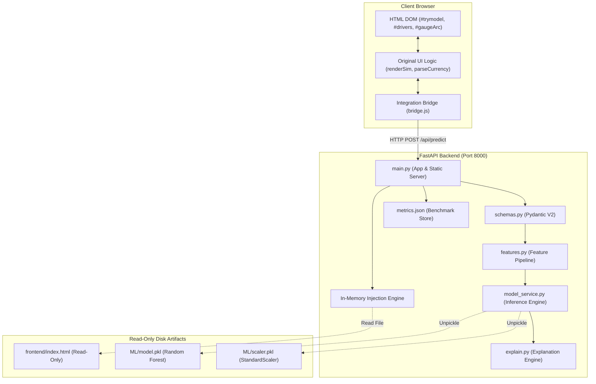
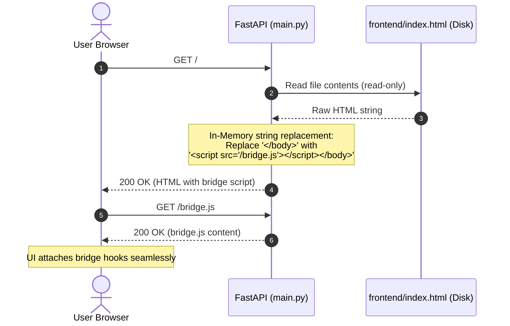
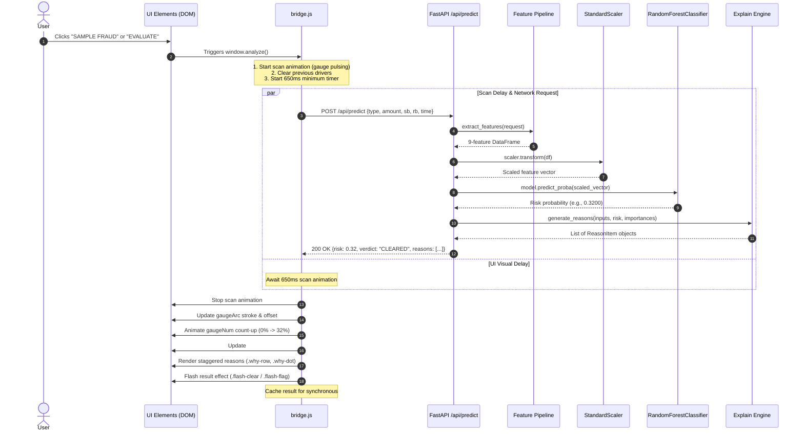
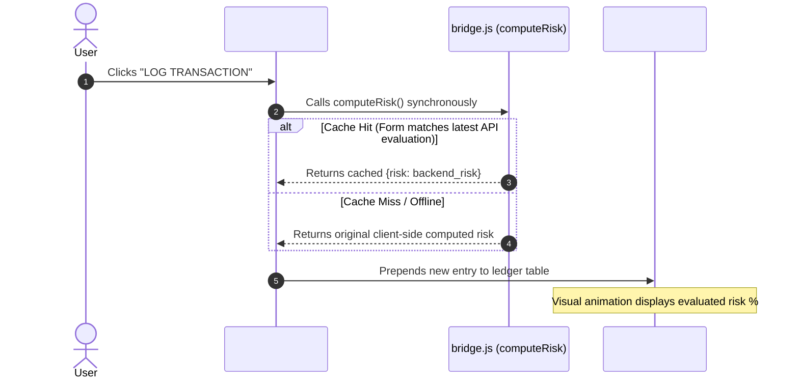

# FRAUD SHIELD System Architecture & Data Flow

This document details the architecture, component interaction, and data flows of the FRAUD SHIELD application.

---

## 1. High-Level Architecture Overview

FRAUD SHIELD consists of three decoupled layers:
1. **Frontend Presentation Layer (`frontend/index.html`):** A pre-rendered, high-fidelity WebGL/GSAP client interface. This layer is strictly read-only on disk.
2. **Integration Bridge (`backend/static/bridge.js`):** Injected in-memory by FastAPI at response time. Intercepts UI evaluation calls, queries the API, and updates DOM elements using identical CSS classes.
3. **ML Backend Service (`backend/app/`):** A FastAPI microservice that extracts domain features, scales vectors, evaluates predictions via a Random Forest classifier, and synthesizes plain-language explanations.

---

## 2. In-Memory Bridge Injection Flow

To comply with the strict rule that `frontend/index.html` cannot be altered on disk, the backend serves the UI dynamically:

---

## 3. End-to-End Prediction Sequence

When a user clicks **"EVALUATE TRANSACTION"** or either of the sample buttons (**"SAMPLE LEGIT"** / **"SAMPLE FRAUD"**):

---

## 4. Synchronous Transaction Logging Flow

When the user clicks the **"LOG TRANSACTION"** button (`#logBtn`):

---

## 5. Offline Fallback Architecture

If the backend server is stopped or network connectivity fails:

1. `fetchPrediction()` in `bridge.js` catches the network error.
2. An informative log is written to `console.warn` for developer diagnostics.
3. The bridge invokes the original `_origRenderSim(true)` function stored on initialization.
4. The user observes the original client-side heuristic without broken layouts, alert dialogs, or unhandled promise rejections.
