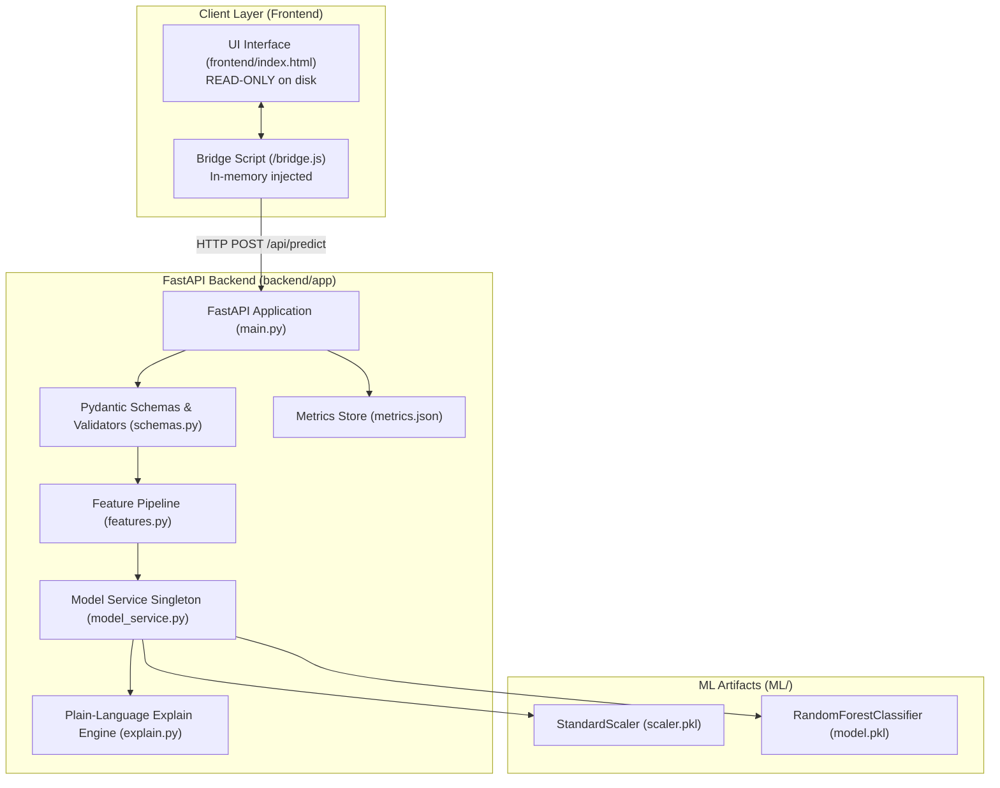

# FRAUD SHIELD Documentation

**FRAUD SHIELD** is a machine learning-powered financial fraud detection system designed for real-time mobile transaction risk assessment. Built around a Random Forest classifier trained on the PaySim financial transaction dataset, FRAUD SHIELD evaluates transaction telemetry, calculates empirical fraud probabilities, and provides non-technical, human-readable risk factors.

---

## 1. System Architecture



---

## 2. Quick Start & Setup

### Prerequisites
- Python 3.11+
- Virtual environment (recommended)

### Installation
```bash
# Navigate to backend directory
cd backend

# Install pinned dependencies
pip install -r requirements.txt
```

### Run Server (Single Command)
```bash
# Start FastAPI application
uvicorn app.main:app --reload --host 127.0.0.1 --port 8000
```

### Accessing the Application
- **Live Interactive UI:** [http://127.0.0.1:8000/](http://127.0.0.1:8000/)
- **Swagger Interactive API Docs:** [http://127.0.0.1:8000/docs](http://127.0.0.1:8000/docs)
- **API Health Check:** [http://127.0.0.1:8000/api/health](http://127.0.0.1:8000/api/health)
- **Model Info & Benchmarks:** [http://127.0.0.1:8000/api/model-info](http://127.0.0.1:8000/api/model-info)

---

## 3. Key Features

1. **Non-Intrusive Integration:** The UI (`frontend/index.html`) is treated as strictly read-only. The backend dynamically injects `bridge.js` in-memory before `</body>` at response time. The file on disk is never modified.
2. **Deterministic Feature Engineering:** Form inputs are mapped into the exact 9 features expected by the trained Random Forest and scaled with the production `StandardScaler`.
3. **Plain-Language Explanations:** Real model weights and transaction attributes are mapped into 4 telemetry signals (`balance_behavior`, `time_pattern`, `transaction_type`, `amount_pattern`) with severity levels (0, 1, 2) without exposing technical feature names.
4. **Graceful Fallback:** If the backend ever goes offline, the UI silently falls back to local client simulation without page errors.
5. **Comprehensive Test Suite:** 99 automated tests covering unit logic, validation limits, golden equivalence, threshold behavior, and API endpoints.

---

## 4. Documentation Index

- [docs/API.md](API.md): API endpoint reference with sample requests and responses.
- [docs/ARCHITECTURE.md](ARCHITECTURE.md): Detailed data flow and sequence diagrams.
- [docs/ML_NOTES.md](ML_NOTES.md): Machine learning methodology, feature details, benchmark metrics, and limitations.
- [docs/TESTING.md](TESTING.md): Test suite execution instructions and test case catalog.
- [docs/DISCOVERY.md](DISCOVERY.md): Pre-implementation discovery findings.
- [docs/UI_HASH.txt](UI_HASH.txt): Cryptographic verification hash of `frontend/index.html`.

---

## 5. Limitations & Ethical Disclaimer

> [!CAUTION]
> **College Educational Demo — Not for Production Financial Decisions**
> 
> 1. **Synthetic Dataset Skew:** The underlying model was trained on the synthetic **PaySim** dataset. While PaySim accurately simulates mobile money behavior, synthetic data contains artificial regularities and distribution skew that differs from real-world banking networks.
> 2. **Concept Drift & Retraining:** Financial fraud patterns evolve rapidly. Static models will suffer from performance degradation as adversaries adapt attack vectors. In production environments, models require continuous monitoring, streaming data pipelines, and scheduled retraining.
> 3. **Non-Financial Advisory:** This project is an academic proof-of-concept for educational demonstration purposes only and should not be used to authorize or block actual financial transactions.
